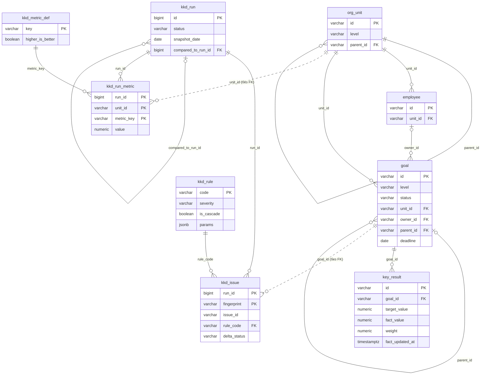

# Модуль ККД: контроль качества данных по целям

**Спецификация для разработки** · тестовое задание «Системный аналитик» · кейс «Контроль качества данных по целям сотрудников» · версия 1.1 от 08.11.2026 · репозиторий: https://github.com/draharle/sber-goal-tracker-sa

По документу пишут код и приёмочные тесты. Весь SQL из документа выполнен на PostgreSQL 18 (PGlite) на тестовом наборе данных: 60 автоматических проверок, см. `sql/test/`. Коды правил, метрик и формат ошибок взяты из mock API модуля ККД — его выдали в материалах кейса вместе с фронтенд-заданием (https://gitverse.ru/kkk_s/moc_api_kkd).

## 0. Введение

**Что делает модуль.** Раз в неделю (и по кнопке) модуль ККД проверяет цели и ключевые результаты в PostgreSQL набором правил, сохраняет найденные проблемы и метрики по каждому подразделению и отдаёт странице ККД три вещи: статистику, список проблем и дельту с прошлым прогоном.

**В рамках:** модель данных, 4 правила (одно на каскад), 3 метрики с учётом каскада, дельта, 3 метода API. **Вне рамок:** вёрстка страницы, ролевая модель (кто какое подразделение видит — проверяет сервис до вызова), остальные 8 правил из mock API (подключаются тем же механизмом: строка в `kkd_rule` + один `SELECT`), выгрузка CSV, срок хранения истории, ручной запуск прогона (отдельный метод, в этот контракт не входит).

**Допущения**

| № | Допущение | Если в реальной системе иначе |
|---|---|---|
| 1 | Данные модуля «Цели» лежат в PostgreSQL ≥ 13. ККД читает их и пишет только в свои таблицы `kkd_*` | Отдельная БД — читать с реплики, логика та же |
| 2 | Оргструктура — дерево с одним корнем (блок): `block → hq → unit` | Несколько блоков — добавить общий корень |
| 3 | Цель относится к подразделению `goal.unit_id`; цель сотрудника — к подразделению сотрудника. Уровни каскада целей: `block → hq → unit → employee` | — |
| 4 | Идентификаторы — строковые коды, как в mock API: `B2B`, `G-00001`, `KR-000001` | Если `bigint` — меняется только тип колонок |
| 5 | Удаление целей и КР физическое | Мягкое удаление — в правила добавить `deleted_at IS NULL` |
| 6 | Даты считаются по Москве (`Europe/Moscow`) | — |
| 7 | Прогон по расписанию — понедельник 06:00 МСК; ручной запуск — тот же механизм; одновременно идёт не больше одного прогона | — |

**Глоссарий**

| Термин | Значение |
|---|---|
| Цель | Запись в `goal`. Уровень `level`: `block`, `hq`, `unit`, `employee`. Статус: `draft`, `active`, `closed`, `cancelled` |
| КР | Ключевой результат цели (`key_result`): целевое и фактическое значение, единица, вес в %, дата обновления факта |
| Активная цель | Цель со `status = 'active'` — и только она. Срок, уровень, наличие КР или ответственного на «активность» не влияют. Правила проверяют только активные цели и КР активных целей; только они входят в метрики |
| Каскад целей | Связь цели с родительской целью вышестоящего уровня (`goal.parent_id`). Цель уровня `block` — вершина, родителя у неё нет |
| Каскад в метриках | Метрика подразделения считается по нему самому и всем дочерним подразделениям (`org_unit.parent_id`) |
| Периметр | Подразделение и все его дочерние на любую глубину |
| Прогон | Один запуск ККД (`kkd_run`): проверяет данные на дату снимка, сохраняет проблемы и метрики. Статусы `running`, `completed`, `failed` |
| Дата снимка | `snapshot_date` — «сегодня» для правил: дата старта прогона по МСК |
| Проблема | Нарушение одного правила одним объектом (целью или КР) в одном прогоне |
| Fingerprint | Ключ проблемы `RULE_CODE:object_id`, например `KR_STALE_PROGRESS:KR-000418`. Одинаковый fingerprint в двух прогонах — это та же проблема |
| Сравниваемый прогон | `compared_to` — последний **успешный** прогон перед текущим |

## 1. Модель данных

Девять таблиц: четыре существующие таблицы модуля «Цели» (ККД их только читает) и пять таблиц ККД. Сплошная линия — внешний ключ, пунктир — ссылка без внешнего ключа.



### 1.1. Таблицы модуля «Цели» (существуют, только чтение)

Указаны поля, которые нужны ККД. Обяз. — `NOT NULL`.

| Таблица.поле | Тип | Обяз. | Описание |
|---|---|---|---|
| `org_unit.id` | varchar(32) | PK | Код подразделения: `B2B`, `HQ-CIB` |
| `org_unit.name` | varchar(255) | да | Название |
| `org_unit.level` | varchar(16) | да | `block`, `hq`, `unit` |
| `org_unit.parent_id` | varchar(32) | нет | FK → `org_unit.id`; `NULL` только у корня |
| `employee.id` | varchar(32) | PK | Табельный код |
| `employee.full_name`, `position` | varchar(255) | да / нет | ФИО, должность |
| `employee.unit_id` | varchar(32) | да | FK → `org_unit.id` |
| `goal.id` | varchar(32) | PK | Код цели |
| `goal.title` | varchar(500) | да | Название |
| `goal.level` | varchar(16) | да | `block`, `hq`, `unit`, `employee` |
| `goal.unit_id` | varchar(32) | да | FK → `org_unit.id` — подразделение цели |
| `goal.owner_id` | varchar(32) | нет | FK → `employee.id` — ответственный |
| `goal.parent_id` | varchar(32) | нет | FK → `goal.id` — родительская цель (каскад) |
| `goal.status` | varchar(16) | да | `draft`, `active`, `closed`, `cancelled` |
| `goal.deadline` | date | нет | Срок достижения |
| `goal.created_at`, `updated_at` | timestamptz | да | Создание, изменение |
| `key_result.id` | varchar(32) | PK | Код КР |
| `key_result.goal_id` | varchar(32) | да | FK → `goal.id` (`ON DELETE CASCADE`) |
| `key_result.title` | varchar(500) | да | Название |
| `key_result.metric_unit` | varchar(32) | нет | Единица измерения: `%`, `шт.`, `млн ₽` |
| `key_result.target_value`, `fact_value` | numeric(18,4) | нет | Целевое и фактическое значение (есть и `baseline_value`) |
| `key_result.weight` | numeric(5,2) | нет | Вес КР в %; `NULL` в сумме весов считается как 0 |
| `key_result.fact_updated_at` | timestamptz | нет | Когда последний раз вносили факт; `NULL` — ни разу |
| `key_result.created_at` | timestamptz | да | Когда создан КР |

### 1.2. Таблицы ККД

| Таблица.поле | Тип | Обяз. | Описание |
|---|---|---|---|
| **`kkd_rule`** — справочник правил | | | |
| `code` | varchar(64) | PK | `GOAL_NO_KR`, `KR_WEIGHTS_SUM`, `CASCADE_NO_PARENT`, `KR_STALE_PROGRESS` |
| `title`, `description`, `recommendation` | varchar(255) / text | да | Название, что проверяет, что исправить |
| `object_type` | varchar(16) | да | `goal` или `key_result` |
| `severity` | varchar(16) | да | `critical`, `major`, `minor` |
| `is_cascade` | boolean | да | Правило на каскад: его проблемы снижают `cascade_coverage` |
| `params` | jsonb | да | Пороги правила, например `{"stale_days": 45}` |
| `is_enabled` | boolean | да | Выключенное правило не запускается |
| **`kkd_metric_def`** — справочник метрик | | | |
| `key` | varchar(64) | PK | `clean_goals_share`, `cascade_coverage`, `issues_total` |
| `title`, `unit`, `formula` | varchar / text | да | Название, единица (`%`, `шт.`), формула словами |
| `higher_is_better` | boolean | да | `true` — рост лучше, `false` — снижение лучше |
| `sort_order` | smallint | да | Порядок вывода, уникален |
| **`kkd_run`** — прогон | | | |
| `id` | bigint identity | PK | Номер прогона. В API — `RUN-` + номер, минимум 3 цифры: `RUN-007`. Номера могут идти с пропусками |
| `status` | varchar(16) | да | `running` → `completed` или `failed` |
| `trigger_type` | varchar(16) | да | `schedule` или `manual` |
| `snapshot_date` | date | да | Дата снимка: «сегодня» для правил (дата старта по МСК) |
| `started_at`, `finished_at` | timestamptz | да / нет | `finished_at` пуст, пока прогон `running` |
| `compared_to_run_id` | bigint | нет | FK → `kkd_run.id`: последний `completed` на момент старта; `NULL` у первого |
| `rule_codes` | varchar(64)[] | да | Какие правила были включены на момент старта |
| `error_message` | text | нет | Обязателен при `failed`, иначе пуст |
| **`kkd_issue`** — найденная проблема | | | |
| `run_id`, `fingerprint` | bigint, varchar(128) | PK | Прогон и ключ проблемы `RULE_CODE:object_id` |
| `issue_id` | varchar(16) | да | `ISS-` + первые 10 hex-символов SHA-256 от fingerprint; одинаков во всех прогонах |
| `rule_code` | varchar(64) | да | FK → `kkd_rule.code` |
| `severity` | varchar(16) | да | Важность правила на момент прогона (копия) |
| `object_type`, `object_id` | varchar | да | Объект: цель или КР и его код |
| `goal_id`, `goal_title`, `goal_level` | varchar | да | Цель (для проблемы КР — цель этого КР); название и уровень — копия на дату снимка |
| `kr_id`, `kr_title` | varchar | нет | Заполнены только для проблем КР |
| `unit_id` | varchar(32) | да | Подразделение цели на дату снимка |
| `owner_id` | varchar(32) | нет | Ответственный за цель |
| `details` | varchar(500) | да | Описание для человека: «Сумма весов КР = 99.5%, ожидается 100%» |
| `actual_value`, `expected_value` | jsonb | нет | Факт и ожидание: число или строка (`99.5` и `100`; `61` и `"<= 45"`) |
| `delta_status` | varchar(16) | да | `new` или `persisting` (`resolved` вычисляется, раздел 4) |
| `first_detected_run_id` | bigint | да | Прогон, с которого проблема держится без перерыва |
| `runs_in_row` | integer | да | Сколько успешных прогонов подряд проблема держится, ≥ 1 |
| **`kkd_run_metric`** — метрики прогона | | | |
| `run_id`, `unit_id`, `metric_key` | bigint, varchar, varchar | PK | Прогон, подразделение, метрика (FK → `kkd_metric_def`) |
| `value` | numeric | нет | Значение: `%` — 1 знак после запятой, `шт.` — целое; `NULL` — нет данных |
| `numerator`, `denominator` | integer | да / нет | Числитель и знаменатель — для подписи «91 из 120» и проверки |

**Ключи и ограничения**

- Все перечисления — `CHECK (... IN (...))`: уровни, статусы, важности, `object_type`, `delta_status`.
- `kkd_run`: `finished_at IS NULL` ⇔ `status = 'running'`; `error_message IS NOT NULL` ⇔ `status = 'failed'`; `compared_to_run_id < id`; частичный уникальный индекс `ON kkd_run ((true)) WHERE status = 'running'` — второй одновременный прогон невозможен даже при гонке.
- `kkd_issue`: PK `(run_id, fingerprint)` — одно правило × один объект дают не больше одной проблемы в прогоне; `UNIQUE (run_id, issue_id)`; `CHECK (fingerprint = rule_code + ':' + object_id)`; `kr_id` заполнен ⇔ `object_type = 'key_result'`; индексы `(run_id, unit_id)` и `(run_id, goal_id)`.
- Из `kkd_*` нет внешних ключей на `goal`, `key_result`, `employee`, `org_unit` — намеренно. Результаты прогона — исторический снимок: цель можно удалить, а прошлый отчёт должен остаться. Поэтому названия цели и КР копируются в проблему.
- `kkd_issue` и `kkd_run_metric` удаляются вместе с прогоном (`ON DELETE CASCADE`).

Полный DDL: `sql/00_source_tables.sql` (стенд), `sql/01_kkd_schema.sql`; откат — `sql/99_kkd_rollback.sql`. Накат → откат → повторный накат проверяется тестом.

## 2. Правила проверки

### 2.1. Общее для всех правил

- Проверяются только **активные** цели (`status = 'active'`) и КР активных целей. Цели `draft`, `closed`, `cancelled` и их КР не проверяются и в метрики не входят.
- Одна проблема = одно правило × один объект. Объект — цель (`object_type = goal`) или КР (`key_result`). У проблемы КР `goal_id` — цель этого КР: по нему проблема попадает в подразделение и метрики.
- Подразделение проблемы — `goal.unit_id` на дату снимка.
- Все правила и метрики прогона считаются в одной транзакции `REPEATABLE READ`: правила и метрики видят один и тот же снимок данных.
- Важность и порог берутся из `kkd_rule`; важность копируется в проблему.
- В SQL четыре `SELECT` ниже объединяются `UNION ALL` в функции `kkd_find_violations(p_snapshot_date, p_rule_codes)`; условие `'CODE' = ANY (p_rule_codes)` отключает выключенное правило.

| Код | Объект | Важность | Каскад | Нарушение | `actual` | `expected` |
|---|---|---|---|---|---|---|
| `GOAL_NO_KR` | goal | critical | нет | У активной цели 0 КР | `0` | `">= 1"` |
| `KR_WEIGHTS_SUM` | goal | major | нет | У активной цели ≥ 1 КР, сумма весов ≠ 100 | сумма, `99.5` | `100` |
| `CASCADE_NO_PARENT` | goal | major | **да** | Активная цель уровня `hq`, `unit`, `employee` без родительской цели | `parent_id` или `null` | `"цель вышестоящего уровня"` |
| `KR_STALE_PROGRESS` | key_result | minor | нет | Факт КР активной цели не обновлялся больше 45 дней | дней, `61` | `"<= 45"` |

Порядок важности: `critical` (Критичная) → `major` (Существенная) → `minor` (Незначительная).

### 2.2. GOAL_NO_KR — цель без ключевых результатов (critical)

**Нарушение:** `goal.status = 'active'` и в `key_result` нет ни одной строки с `goal_id` этой цели.

**Граничные случаи:** КР с пустыми полями (нет цели, нет факта) — это КР, правило не срабатывает. Цель уровня `block` проверяется так же. Черновик без КР — не проверяется.

```sql
-- R1. GOAL_NO_KR: у активной цели нет ни одного КР
SELECT 'GOAL_NO_KR' AS rule_code, 'goal' AS object_type, g.id AS object_id,
       g.id AS goal_id, g.title AS goal_title, g.level AS goal_level,
       NULL AS kr_id, NULL AS kr_title, g.unit_id, g.owner_id,
       'У цели 0 ключевых результатов' AS details,
       to_jsonb(0) AS actual_value, to_jsonb('>= 1'::text) AS expected_value
  FROM goal g
 WHERE g.status = 'active'
   AND NOT EXISTS (SELECT 1 FROM key_result kr WHERE kr.goal_id = g.id)
   AND 'GOAL_NO_KR' = ANY (p_rule_codes)
```

### 2.3. KR_WEIGHTS_SUM — сумма весов КР не равна 100% (major)

**Нарушение:** у активной цели есть хотя бы один КР и `ROUND(SUM(COALESCE(weight, 0)), 2) <> 100`. Сравнение точное, без допуска: вес хранится в `numeric(5,2)`, ошибок округления нет. Если в источнике `double` — `ROUND(..., 2)` приводит сумму к двум знакам до сравнения. Если бизнес решит вводить веса только целыми процентами, правило не меняется: целые веса — частный случай.

| Веса КР | Сумма | Результат |
|---|---|---|
| 60 + 39.5 | 99.5 | нарушение, `actual = 99.5` |
| 50 + 50 | 100 | нормально |
| 60 + 40.5 | 100.5 | нарушение, `actual = 100.5` |
| 33.33 + 33.33 + 33.33 | 99.99 | нарушение — веса нужно довести до 100 |
| один КР, вес `NULL` | 0 | нарушение |
| КР нет | — | не проверяется: это `GOAL_NO_KR` |

```sql
-- R2. KR_WEIGHTS_SUM: сумма весов КР активной цели не равна 100 (точное сравнение numeric)
SELECT 'KR_WEIGHTS_SUM' AS rule_code, 'goal' AS object_type, g.id AS object_id,
       g.id AS goal_id, g.title AS goal_title, g.level AS goal_level,
       NULL AS kr_id, NULL AS kr_title, g.unit_id, g.owner_id,
       format('Сумма весов КР = %s%%, ожидается 100%%', trim_scale(w.total)) AS details,
       to_jsonb(trim_scale(w.total)) AS actual_value, to_jsonb(100) AS expected_value
  FROM goal g
  JOIN (SELECT kr.goal_id, ROUND(SUM(COALESCE(kr.weight, 0)), 2) AS total
          FROM key_result kr
         GROUP BY kr.goal_id) w ON w.goal_id = g.id      -- цели без КР сюда не попадают
 WHERE g.status = 'active'
   AND w.total <> 100
   AND 'KR_WEIGHTS_SUM' = ANY (p_rule_codes)
```

### 2.4. CASCADE_NO_PARENT — цель не связана с вышестоящей (major, правило на каскад)

**Нарушение:** активная цель с `level <> 'block'` и (`parent_id IS NULL` или цели с таким `parent_id` нет).

| Ситуация | Результат |
|---|---|
| Цель уровня `block` без родителя | нормально: вершина каскада, не проверяется |
| Цель `hq`, `unit` или `employee` без родителя | нарушение |
| Родитель указан, но такой цели нет (удалили без FK) | нарушение, `details` = «Родительская цель G-… не найдена» |
| Родитель в статусе `draft`, `closed` или `cancelled` | нормально для этого правила: связь есть. Статус родителя — отдельное правило `CASCADE_PARENT_INACTIVE`, вне этой версии |
| Родитель не выше по уровню или из чужой ветки оргструктуры | нормально для этого правила. Это отдельное правило `CASCADE_WRONG_LEVEL`, вне этой версии |

```sql
-- R3. CASCADE_NO_PARENT: активная цель ниже уровня блока без родительской цели
SELECT 'CASCADE_NO_PARENT' AS rule_code, 'goal' AS object_type, g.id AS object_id,
       g.id AS goal_id, g.title AS goal_title, g.level AS goal_level,
       NULL AS kr_id, NULL AS kr_title, g.unit_id, g.owner_id,
       CASE WHEN g.parent_id IS NULL THEN 'Родительская цель не указана'
            ELSE format('Родительская цель %s не найдена', g.parent_id) END AS details,
       to_jsonb(g.parent_id) AS actual_value,
       to_jsonb('цель вышестоящего уровня'::text) AS expected_value
  FROM goal g
 WHERE g.status = 'active'
   AND g.level <> 'block'
   AND (g.parent_id IS NULL
        OR NOT EXISTS (SELECT 1 FROM goal p WHERE p.id = g.parent_id))
   AND 'CASCADE_NO_PARENT' = ANY (p_rule_codes)
```

### 2.5. KR_STALE_PROGRESS — прогресс КР давно не обновлялся (minor)

**Нарушение:** КР активной цели, у которого `age_days > stale_days` (45, из `kkd_rule.params`), где `age_days = snapshot_date − дата(COALESCE(fact_updated_at, created_at))` по МСК, целое число дней.

| Ситуация (дата снимка 02.11.2026) | `age_days` | Результат |
|---|---|---|
| Факт обновлён 18.09 | 45 | нормально: ровно 45 — ещё не нарушение |
| Факт обновлён 17.09 | 46 | нарушение |
| Факт обновлён 17.09 в 22:30 UTC (= 18.09 01:30 МСК) | 45 | нормально: дата берётся по МСК |
| Факт ни разу не вносили, КР создан 01.08 | 93 | нарушение, «Факт ни разу не вносился, КР создан 93 дн. назад» |
| Дата обновления позже даты снимка | < 0 | нормально |
| Факт уже ≥ цели | — | всё равно проверяется: правило о свежести данных, а не о выполнении |

```sql
-- R4. KR_STALE_PROGRESS: факт КР активной цели не обновлялся больше stale_days (45) дней
SELECT 'KR_STALE_PROGRESS' AS rule_code, 'key_result' AS object_type, kr.id AS object_id,
       g.id AS goal_id, g.title AS goal_title, g.level AS goal_level,
       kr.id AS kr_id, kr.title AS kr_title, g.unit_id, g.owner_id,
       CASE WHEN kr.fact_updated_at IS NULL
            THEN format('Факт ни разу не вносился, КР создан %s дн. назад', a.age_days)
            ELSE format('Факт обновлялся %s дн. назад', a.age_days) END AS details,
       to_jsonb(a.age_days) AS actual_value,
       to_jsonb('<= ' || (r.params ->> 'stale_days')) AS expected_value
  FROM key_result kr
  JOIN goal g ON g.id = kr.goal_id
  JOIN kkd_rule r ON r.code = 'KR_STALE_PROGRESS'
 CROSS JOIN LATERAL (
       SELECT p_snapshot_date
              - (COALESCE(kr.fact_updated_at, kr.created_at) AT TIME ZONE 'Europe/Moscow')::date
              AS age_days) a
 WHERE g.status = 'active'
   AND a.age_days > (r.params ->> 'stale_days')::int
   AND 'KR_STALE_PROGRESS' = ANY (p_rule_codes)
```

## 3. Метрики качества

| Ключ | Название | Ед. | Лучше | Числитель | Знаменатель | Значение |
|---|---|---|---|---|---|---|
| `clean_goals_share` | Доля корректных целей | % | рост | Активные цели периметра без единой проблемы (ни по цели, ни по её КР) | Все активные цели периметра | `ROUND(100 × ч / з, 1)`; з = 0 → `null` |
| `cascade_coverage` | Покрытие каскадом | % | рост | Активные цели периметра уровня ≠ `block` без проблем каскадных правил (`is_cascade`; сейчас это `CASCADE_NO_PARENT`) | Активные цели периметра уровня ≠ `block` | `ROUND(100 × ч / з, 1)`; з = 0 → `null` |
| `issues_total` | Найдено проблем | шт. | снижение | Проблемы прогона у целей периметра, включая проблемы их КР | — | числитель; `null`, если активных целей в периметре нет |

**Каскад по оргструктуре.** Периметр подразделения — оно само и все потомки (рекурсивный CTE по `org_unit.parent_id`). Метрика считается по **объединению целей периметра**, а не как среднее метрик дочерних. Пример из тестов: у CIB-KEY покрытие 100.0 (3 из 3), у CIB-REG — 50.0 (1 из 2), у департамента HQ-CIB одна своя цель со связью. Покрытие HQ-CIB = 5 из 6 = **83.3**, а не (100 + 50) / 2 = 75. Каждая цель входит в метрику своего подразделения и всех вышестоящих ровно один раз.

**Правила расчёта**

- **Округление:** `ROUND(x, 1)` над `numeric`, половина — от нуля (66.65 → 66.7). В Java — `BigDecimal.setScale(1, RoundingMode.HALF_UP)`, не `double`.
- **`null`, а не 0.** Процент с нулевым знаменателем — `null` («нет данных»), UI показывает «—» и «нет активных целей». Ноль — это реальный результат («ни одной корректной цели»), его с отсутствием данных путать нельзя. `issues_total` тоже `null`, если целей нет: иначе новое пустое подразделение выглядело бы «зелёным» (0 проблем).
- **Хранение.** В конце прогона метрики считаются для **каждого** подразделения оргструктуры и сохраняются в `kkd_run_metric` с числителем и знаменателем. Прошлые значения не пересчитываются: данные целей меняются, а прошлый прогон должен показывать то, что было на его дату.
- Разбивки по важности и правилам — не метрики, а счётчики найденного: там всегда число (0, если проблем нет).

```sql
-- M1. Метрики по каждому подразделению: само подразделение + все дочерние
INSERT INTO kkd_run_metric (run_id, unit_id, metric_key, value, numerator, denominator)
WITH RECURSIVE subtree AS (            -- пары (подразделение, оно само или его потомок)
    SELECT u.id AS root_id, u.id AS unit_id FROM org_unit u
    UNION                              -- UNION, а не UNION ALL: защита от цикла в иерархии
    SELECT s.root_id, c.id FROM subtree s JOIN org_unit c ON c.parent_id = s.unit_id
),
goal_flags AS (                        -- активные цели и их проблемы в этом прогоне
    SELECT g.id, g.unit_id, g.level,
           (SELECT count(*) FROM kkd_issue i
             WHERE i.run_id = p_run_id AND i.goal_id = g.id) AS issues,
           EXISTS (SELECT 1 FROM kkd_issue i JOIN kkd_rule rl ON rl.code = i.rule_code
                    WHERE i.run_id = p_run_id AND i.goal_id = g.id
                      AND rl.is_cascade) AS has_cascade_issue
      FROM goal g
     WHERE g.status = 'active'
),
agg AS (
    SELECT s.root_id AS unit_id,
           count(gf.id)                                        AS goals_active,
           count(gf.id) FILTER (WHERE gf.issues = 0)           AS goals_clean,
           count(gf.id) FILTER (WHERE gf.level <> 'block')     AS goals_non_block,
           count(gf.id) FILTER (WHERE gf.level <> 'block'
                                  AND NOT gf.has_cascade_issue) AS goals_cascaded,
           COALESCE(sum(gf.issues), 0)                         AS issues
      FROM subtree s
      LEFT JOIN goal_flags gf ON gf.unit_id = s.unit_id
     GROUP BY s.root_id
)
SELECT p_run_id, a.unit_id, m.metric_key, m.value, m.numerator, m.denominator
  FROM agg a
 CROSS JOIN LATERAL (VALUES
       ('clean_goals_share', ROUND(100.0 * a.goals_clean / NULLIF(a.goals_active, 0), 1),
                             a.goals_clean, a.goals_active),
       ('cascade_coverage',  ROUND(100.0 * a.goals_cascaded / NULLIF(a.goals_non_block, 0), 1),
                             a.goals_cascaded, a.goals_non_block),
       ('issues_total',      CASE WHEN a.goals_active > 0 THEN a.issues END,
                             a.issues, NULL)
 ) AS m (metric_key, value, numerator, denominator);
```

## 4. Дельта с прошлым прогоном

### 4.1. Как понять, что проблема «та же самая»

Ключ проблемы — **fingerprint** = `rule_code || ':' || object_id`, например `KR_WEIGHTS_SUM:G-00152`. Одинаковый fingerprint в двух прогонах — та же проблема. В ключ **не входят**: детали и факт (сумма весов была 100.5, стала 110 — та же проблема), подразделение (цель перенесли — та же проблема), важность, названия. Строки `kkd_issue` пересоздаются каждый прогон, их служебные id разные, а fingerprint вычисляется из данных и одинаков без хранения состояния. Для URL и фронтенда — `issue_id` = `ISS-` + первые 10 hex SHA-256 от fingerprint: тоже стабилен.

### 4.2. С каким прогоном сравниваем

`compared_to` — прогон с наибольшим номером среди `completed` с меньшим номером. Он записывается в `kkd_run.compared_to_run_id` при старте (`SELECT max(id) FROM kkd_run WHERE status = 'completed'`): в этот момент других `running` нет, все прошлые прогоны завершены, поэтому значение больше не меняется.

| Статус | Когда | Что хранится |
|---|---|---|
| `new` | fingerprint есть в текущем, нет в сравниваемом. Сюда же — проблема, которая была, исправлялась и вернулась | `first_detected_run_id` = текущий, `runs_in_row` = 1 |
| `persisting` | fingerprint есть в обоих | `first_detected_run_id` переносится, `runs_in_row` + 1; `details` и `actual` — свежие |
| `resolved` | fingerprint есть в сравниваемом, нет в текущем, и правило входит в `rule_codes` текущего прогона. Причина не важна: исправили данные, цель закрыли, отменили или удалили | не хранится, вычисляется в `kkd_issue_feed` |

Выключенное правило не даёт `resolved`: «не проверяли» не значит «исправили».

### 4.3. Особые случаи

| Ситуация | Поведение |
|---|---|
| **Первый прогон** (успешных до него нет) | `compared_to = null`; у метрик `previous`, `delta`, `delta_pct`, `trend` = `null`; `delta.new / persisting / resolved` = `null`, не 0; в разбивках `previous` и `delta` = `null`. Проблемы — `new`, `runs_in_row` = 1. UI: «Первый прогон — сравнивать не с чем» |
| **Прошлый прогон упал** | Пропускается: сравниваем с последним успешным до него (RUN-006 упал → RUN-007 сравнивается с RUN-005). В ответе `compared_to` показывает, с каким именно |
| **Прогон падает** | Проблемы, метрики и статус пишутся в одной транзакции; при ошибке всё откатывается, затем записываются `status = 'failed'`, `error_message`, `finished_at`. У упавшего прогона нет частичных результатов. Его результаты по API — 409 `RUN_FAILED` |
| **Прогон ещё выполняется** | Явный `run_id` → 409 `RUN_IN_PROGRESS`. `run_id=latest` → последний `completed`: страница продолжает показывать прошлые результаты. Новый запуск, пока идёт прогон, → 409 `RUN_IN_PROGRESS` |
| **Прогон завис** (> 2 часов в `running`) | При следующем запуске помечается `failed`: «Превышено время выполнения прогона (2 часа)» |
| **Подразделение появилось после сравниваемого прогона** | Сохранённой строки нет → `previous = null`, `delta` и `trend` = `null` |

### 4.4. Дельта метрик и trend

- `delta = value − previous` по **сохранённым округлённым** значениям — как на экране: 66.7 − 33.3 = 33.4. Для метрик в % — это процентные пункты.
- `delta_pct = ROUND(100 × delta / previous, 1)` — относительное изменение; `previous = 0` → `null`.
- `trend`: `null`, если `value` или `previous` = `null`; `same`, если `delta = 0`; иначе `better`, если (`delta > 0`) совпадает с `higher_is_better`, и `worse`, если нет. Знак дельты ≠ оценка: `issues_total` 5 → 6 — это `delta = +1`, `trend = worse`; `clean_goals_share` 50.0 → 37.5 — `delta = −12.5`, `worse`.

Запись проблем прогона с дельтой (шаг функции `kkd_execute_run`):

```sql
-- D1. Проблемы прогона + дельта с предыдущим успешным прогоном
INSERT INTO kkd_issue (run_id, fingerprint, issue_id, rule_code, severity, object_type,
                       object_id, goal_id, goal_title, goal_level, kr_id, kr_title,
                       unit_id, owner_id, details, actual_value, expected_value,
                       delta_status, first_detected_run_id, runs_in_row)
SELECT p_run_id, f.fp,
       'ISS-' || upper(left(encode(sha256(convert_to(f.fp, 'UTF8')), 'hex'), 10)),
       v.rule_code, rl.severity, v.object_type,
       v.object_id, v.goal_id, v.goal_title, v.goal_level, v.kr_id, v.kr_title,
       v.unit_id, v.owner_id, v.details, v.actual_value, v.expected_value,
       CASE WHEN prev.fingerprint IS NULL THEN 'new' ELSE 'persisting' END,
       COALESCE(prev.first_detected_run_id, p_run_id),
       COALESCE(prev.runs_in_row, 0) + 1
  FROM kkd_find_violations(v_run.snapshot_date, v_run.rule_codes) v
 CROSS JOIN LATERAL (SELECT v.rule_code || ':' || v.object_id AS fp) f
  JOIN kkd_rule rl ON rl.code = v.rule_code
  LEFT JOIN kkd_issue prev ON prev.run_id = v_run.compared_to_run_id   -- NULL у первого прогона
                          AND prev.fingerprint = f.fp;
```

Лента проблем с `resolved` и запрос метрик с дельтой для `summary`:

```sql
-- Лента проблем прогона с дельтой: new / persisting (из прогона) + resolved (из прошлого)
CREATE VIEW kkd_issue_feed AS
SELECT i.run_id, i.issue_id, i.fingerprint, i.rule_code, i.severity, i.object_type,
       i.object_id, i.goal_id, i.goal_title, i.goal_level, i.kr_id, i.kr_title,
       i.unit_id, i.owner_id, i.details, i.actual_value, i.expected_value,
       i.delta_status, i.first_detected_run_id, i.runs_in_row
  FROM kkd_issue i
UNION ALL
SELECT r.id, p.issue_id, p.fingerprint, p.rule_code, p.severity, p.object_type,
       p.object_id, p.goal_id, p.goal_title, p.goal_level, p.kr_id, p.kr_title,
       p.unit_id, p.owner_id, p.details, p.actual_value, p.expected_value,
       'resolved', p.first_detected_run_id, p.runs_in_row
  FROM kkd_run r
  JOIN kkd_issue p ON p.run_id = r.compared_to_run_id
 WHERE r.status = 'completed'
   AND p.rule_code = ANY (r.rule_codes)        -- выключенное правило не даёт «исправлений»
   AND NOT EXISTS (SELECT 1 FROM kkd_issue c
                    WHERE c.run_id = r.id AND c.fingerprint = p.fingerprint);
```

```sql
-- Метрики для GET /api/kkd/summary: значение, прошлое значение, дельта, тренд
PREPARE kkd_summary_metrics (bigint, varchar) AS
SELECT d.key, d.title, d.unit, d.higher_is_better, d.formula,
       cur.value, cur.numerator, cur.denominator,
       prev.value                                                        AS previous,
       cur.value - prev.value                                            AS delta,
       ROUND(100 * (cur.value - prev.value) / NULLIF(prev.value, 0), 1) AS delta_pct,
       CASE WHEN cur.value IS NULL OR prev.value IS NULL      THEN NULL
            WHEN cur.value = prev.value                       THEN 'same'
            WHEN (cur.value > prev.value) = d.higher_is_better THEN 'better'
            ELSE 'worse' END                                             AS trend
  FROM kkd_run r
 CROSS JOIN kkd_metric_def d
  LEFT JOIN kkd_run_metric cur  ON cur.run_id = r.id
                               AND cur.unit_id = $2 AND cur.metric_key = d.key
  LEFT JOIN kkd_run_metric prev ON prev.run_id = r.compared_to_run_id
                               AND prev.unit_id = $2 AND prev.metric_key = d.key
 WHERE r.id = $1
 ORDER BY d.sort_order;
```

## 5. Контракт API

### 5.1. Общее

- REST, JSON в UTF-8, методы `GET` без тела. Авторизация и доступ к подразделениям проверяются сервисом до логики ККД.
- `run_id`: `RUN-007` (`RUN-` + номер, минимум 3 цифры) или `latest` — по умолчанию; `latest` = последний `completed`.
- `unit_id`: код подразделения; по умолчанию — корень оргструктуры (`B2B`). Ответ всегда по периметру: подразделение + дочерние.
- Даты — `YYYY-MM-DD`; моменты времени — ISO 8601 с поясом МСК: `2026-11-02T06:00:00+03:00`.
- Числа: `%` — один знак после запятой, `шт.` — целые; `null` — «нет данных».
- Порядок проверок: 1) формат параметров → 422 (кроме `run_id`: кривой или неизвестный `run_id` → 404 `RUN_NOT_FOUND`); 2) `unit_id` → 404; 3) `run_id` → 404; 4) статус прогона → 409. Неизвестные параметры игнорируются.
- Ошибка — всегда в одном формате: `{"error": {"code": "RUN_FAILED", "message": "Прогон RUN-006 завершился с ошибкой — результатов нет"}}`. `message` — для пользователя, по-русски.

| HTTP | `code` | Когда |
|---|---|---|
| 404 | `RUN_NOT_FOUND` | Нет прогона с таким номером или `run_id` не в формате; `latest`, а успешных прогонов ещё нет («Успешных прогонов ещё нет») |
| 404 | `UNIT_NOT_FOUND` | Нет подразделения с таким кодом |
| 409 | `RUN_FAILED` | Запрошены результаты упавшего прогона |
| 409 | `RUN_IN_PROGRESS` | Запрошены результаты прогона, который ещё выполняется |
| 422 | `INVALID_PARAM` | Значение вне допустимого: `limit=0`, `sort=foo`, `severity=high`, `q` длиннее 100 символов. В `message` — какой параметр и что допустимо |
| 500 | `INTERNAL_ERROR` | Непредвиденная ошибка; без технических деталей в `message` |

### 5.2. `GET /api/runs` — история прогонов

| Параметр | Тип | По умолчанию | Валидация |
|---|---|---|---|
| `limit` | int | 20 | 1…100, иначе 422 |
| `offset` | int | 0 | ≥ 0, иначе 422 |

Ответ 200: `{"items": [Run], "total": 8, "limit": 20, "offset": 0}`, новые сверху. В списке все прогоны, включая `running` и `failed`. Прогонов нет — `items: []`, `total: 0`.

| Поле `Run` | Тип | Описание |
|---|---|---|
| `id`, `number` | string, int | `RUN-007`, 7 |
| `status`, `trigger` | string | `running` / `completed` / `failed`; `schedule` / `manual` |
| `snapshot_date` | date | Дата снимка |
| `started_at`, `finished_at` | datetime | `finished_at = null`, пока `running` |
| `compared_to_run_id` | string \| null | С каким прогоном сравнивается; `null` у первого |
| `error` | string \| null | Текст ошибки, только у `failed` |
| `totals` | object \| null | Только у `completed`, по корню: `goals_active`, `issues_total`, `critical`, `major`, `minor`, `clean_goals_share`. В `summary` не передаётся |

### 5.3. `GET /api/kkd/summary?run_id&unit_id` — статистика и дельта

Параметры: `run_id`, `unit_id` (см. 5.1). Ошибки: 404 `UNIT_NOT_FOUND`, 404 `RUN_NOT_FOUND`, 409 `RUN_FAILED`, 409 `RUN_IN_PROGRESS`.

| Поле | Описание |
|---|---|
| `run`, `compared_to` | `Run` без `totals`; `compared_to = null` у первого прогона |
| `unit` | `id`, `name`, `level`, `parent_id`, `path` — цепочка от корня до подразделения |
| `metrics[]` | 3 метрики в порядке `sort_order`: `key`, `title`, `unit`, `higher_is_better`, `formula`, `value`, `numerator`, `denominator`, `previous`, `delta`, `delta_pct`, `trend` |
| `issues_by_severity[]` | Всегда 3 строки `critical`, `major`, `minor`: `code`, `title`, `current`, `previous`, `delta`. `previous` — по правилам текущего прогона |
| `issues_by_rule[]` | По правилам прогона (`rule_codes`), сортировка: важность, затем код: `code`, `title`, `severity`, `object_type`, `current`, `previous`, `delta` |
| `delta` | `new`, `persisting`, `resolved` — счётчики проблем периметра; все `null` у первого прогона |

Пример целиком: `GET /api/kkd/summary?run_id=RUN-007&unit_id=HQ-CIB`, прогон RUN-006 упал, поэтому сравнение с RUN-005.

```json
{
  "run": {
    "id": "RUN-007", "number": 7, "status": "completed", "trigger": "schedule",
    "snapshot_date": "2026-10-26",
    "started_at": "2026-10-26T06:00:00+03:00", "finished_at": "2026-10-26T06:11:00+03:00",
    "compared_to_run_id": "RUN-005", "error": null
  },
  "compared_to": {
    "id": "RUN-005", "number": 5, "status": "completed", "trigger": "schedule",
    "snapshot_date": "2026-10-12",
    "started_at": "2026-10-12T06:00:00+03:00", "finished_at": "2026-10-12T06:09:00+03:00",
    "compared_to_run_id": "RUN-004", "error": null
  },
  "unit": {
    "id": "HQ-CIB", "name": "Департамент корпоративного бизнеса", "level": "hq", "parent_id": "B2B",
    "path": [ { "id": "B2B", "name": "Корпоративный блок" },
              { "id": "HQ-CIB", "name": "Департамент корпоративного бизнеса" } ]
  },
  "metrics": [
    { "key": "clean_goals_share", "title": "Доля корректных целей", "unit": "%",
      "higher_is_better": true, "formula": "активные цели без проблем ÷ все активные цели × 100",
      "value": 75.8, "numerator": 91, "denominator": 120,
      "previous": 75.0, "delta": 0.8, "delta_pct": 1.1, "trend": "better" },
    { "key": "cascade_coverage", "title": "Покрытие каскадом", "unit": "%",
      "higher_is_better": true,
      "formula": "активные цели (кроме уровня блока) без проблем каскада ÷ все такие цели × 100",
      "value": 92.5, "numerator": 111, "denominator": 120,
      "previous": 97.4, "delta": -4.9, "delta_pct": -5.0, "trend": "worse" },
    { "key": "issues_total", "title": "Найдено проблем", "unit": "шт.",
      "higher_is_better": false, "formula": "количество нарушений правил ККД",
      "value": 36, "numerator": 36, "denominator": null,
      "previous": 33, "delta": 3, "delta_pct": 9.1, "trend": "worse" }
  ],
  "issues_by_severity": [
    { "code": "critical", "title": "Критичная",      "current": 4,  "previous": 4,  "delta": 0 },
    { "code": "major",    "title": "Существенная",   "current": 15, "previous": 11, "delta": 4 },
    { "code": "minor",    "title": "Незначительная", "current": 17, "previous": 18, "delta": -1 }
  ],
  "issues_by_rule": [
    { "code": "GOAL_NO_KR", "title": "Цель без ключевых результатов", "severity": "critical",
      "object_type": "goal", "current": 4, "previous": 4, "delta": 0 },
    { "code": "CASCADE_NO_PARENT", "title": "Цель не связана с вышестоящей", "severity": "major",
      "object_type": "goal", "current": 9, "previous": 3, "delta": 6 },
    { "code": "KR_WEIGHTS_SUM", "title": "Сумма весов КР не равна 100%", "severity": "major",
      "object_type": "goal", "current": 6, "previous": 8, "delta": -2 },
    { "code": "KR_STALE_PROGRESS", "title": "Прогресс КР давно не обновлялся", "severity": "minor",
      "object_type": "key_result", "current": 17, "previous": 18, "delta": -1 }
  ],
  "delta": { "new": 9, "persisting": 27, "resolved": 6 }
}
```

Числа в примере согласованы: 36 = 4 + 15 + 17 = 9 new + 27 persisting; 33 = 27 persisting + 6 resolved; покрытие 111 = 120 − 9 целей с `CASCADE_NO_PARENT`.

### 5.4. `GET /api/kkd/issues` — найденные проблемы

| Параметр | Тип | По умолчанию | Значения и валидация |
|---|---|---|---|
| `run_id`, `unit_id` | string | `latest`, корень | см. 5.1 |
| `rule_code` | csv | все | Коды из `kkd_rule` через запятую; неизвестный код → 422 |
| `severity` | csv | все | `critical`, `major`, `minor` |
| `delta_status` | csv | `new,persisting` | `new`, `persisting`, `resolved`. Исправленные приходят **только** если `resolved` указан явно |
| `object_type` | string | все | `goal` или `key_result` |
| `q` | string | — | 1…100 символов после обрезки пробелов; пусто — фильтр не применяется. Подстрока без учёта регистра по `id` проблемы, коду и названию цели, коду и названию КР, ФИО ответственного. Символы `%`, `_`, `\` экранирует сервис перед вызовом функции |
| `sort` | string | `severity` | `severity`, `age`, `unit`, `rule` (таблица ниже) |
| `limit` | int | 20 | 1…200 |
| `offset` | int | 0 | ≥ 0; `offset ≥ total` → пустая страница, не ошибка |

| `sort` | Порядок (последние ключи делают порядок однозначным для пагинации) |
|---|---|
| `severity` | важность (critical → minor), `runs_in_row` по убыванию, `object_id`, `rule_code` |
| `age` | `runs_in_row` по убыванию, важность, `object_id`, `rule_code` |
| `unit` | название подразделения, важность, `object_id`, `rule_code` |
| `rule` | `rule_code`, `object_id` |

Ответ 200: `{"run_id": "RUN-007", "items": [Issue], "total": 36, "limit": 20, "offset": 0}`. `total` — число проблем после фильтров до пагинации; считается отдельным `count(*)`, не оконной функцией: на пустой странице окно не вернёт ни строки. Ошибки — как у `summary` плюс 422 `INVALID_PARAM`. Элемент `Issue`:

```json
{
  "id": "ISS-D8E2D3AE1D", "fingerprint": "KR_STALE_PROGRESS:KR-000418",
  "rule_code": "KR_STALE_PROGRESS", "rule_title": "Прогресс КР давно не обновлялся",
  "severity": "minor", "object_type": "key_result", "object_id": "KR-000418",
  "goal_id": "G-00152", "goal_title": "Рост кросс-продаж", "goal_level": "employee",
  "kr_id": "KR-000418", "kr_title": "Количество закрытых сделок",
  "unit_id": "CIB-KEY", "unit_name": "Управление по работе с ключевыми клиентами",
  "owner": { "id": "E-0042", "full_name": "Сотрудник 0042", "position": "Клиентский менеджер" },
  "details": "Факт обновлялся 61 дн. назад", "actual": 61, "expected": "<= 45",
  "recommendation": "Обновить фактическое значение КР.",
  "delta_status": "persisting", "first_detected_run_id": "RUN-004",
  "first_detected_at": "2026-10-05", "runs_in_row": 3
}
```

`owner = null`, если ответственный не указан. `kr_id`, `kr_title` = `null` у проблем цели. У `resolved` все поля — из сравниваемого прогона. `runs_in_row` = 3: прогоны 4, 5, 7 (упавший 6 не считается). Фильтры — функция `kkd_issues_filtered`, страница и `total` — `sql/03_kkd_api_queries.sql`.

### 5.5. Граничные случаи

| Случай | `GET /api/runs` | `GET /api/kkd/summary` | `GET /api/kkd/issues` |
|---|---|---|---|
| Подразделение без целей | — | 200; `value` всех метрик и `trend` = `null`; `numerator` = 0; разбивки — нули | 200, `items: []`, `total: 0` |
| Цель без КР | — | Одна проблема `GOAL_NO_KR` (critical): цель некорректна в `clean_goals_share`, `cascade_coverage` не меняется | Одна строка; `KR_WEIGHTS_SUM` и проблем КР у цели нет |
| Прогон ещё выполняется | `status: running`, `finished_at: null`, `totals: null` | явный `run_id` → 409 `RUN_IN_PROGRESS`; `latest` → последний `completed` | так же |
| Прогон упал | `status: failed`, `error`, `totals: null` | 409 `RUN_FAILED`; следующий прогон сравнивается с последним успешным | 409 `RUN_FAILED` |
| Первый прогон | `compared_to_run_id: null` | `compared_to`, `previous`, `delta`, `delta_pct`, `trend`, счётчики `delta` = `null` | все `new`; `delta_status=resolved` → пусто |
| Успешных прогонов нет | `items` со статусами `running` / `failed` | `latest` → 404 `RUN_NOT_FOUND` | 404 `RUN_NOT_FOUND` |
| Неизвестный `unit_id` / `run_id` | — | 404 `UNIT_NOT_FOUND` / `RUN_NOT_FOUND` | так же |

## 6. Критерии приёмки

«SQL» — проверено автотестом `sql/test/20_test_scenario.sql` на PostgreSQL; «API» — проверяет тест бэкенда.

| № | Дано | Когда | Тогда | Тест |
|---|---|---|---|---|
| 1 | Три активные цели с весами КР 60 + 39.5, 50 + 50, 60 + 40.5 | прогон | `KR_WEIGHTS_SUM` у первой (`actual` 99.5) и третьей (100.5), у второй нет | SQL |
| 2 | КР активных целей, факт обновлён 45 и 46 дней назад по МСК | прогон | проблема `KR_STALE_PROGRESS` только у КР с 46 днями | SQL |
| 3 | Активная цель без КР | прогон | ровно одна проблема — `GOAL_NO_KR`, без `KR_WEIGHTS_SUM` | SQL |
| 4 | Активные цели без родителя уровней `block` и `hq`; цель сотрудника с родителем-черновиком | прогон | `CASCADE_NO_PARENT` только у цели `hq` | SQL |
| 5 | Цели `draft` и `closed` без КР и без родителя | прогон | проблем нет, в метрики не входят | SQL |
| 6 | Покрытие каскадом CIB-KEY 3/3, CIB-REG 1/2, у HQ-CIB одна своя корректная цель | метрики | у HQ-CIB `cascade_coverage` = 83.3 (5/6), не 75 | SQL |
| 7 | Подразделение без активных целей | `GET summary`, `GET issues` | 200; метрики `null`, `trend` `null`; список пуст, `total` 0 | SQL + API |
| 8 | Прогон 1 успешен, 2 упал, 3 успешен | прогон 3; `GET summary?run_id=RUN-002` | 3 сравнивается с 1; у 2 нет проблем и метрик; ответ 409 `RUN_FAILED` | SQL + API |
| 9 | Сумма весов цели 100.5, к следующему прогону — 110 | прогон | та же проблема: тот же `issue_id`, `persisting`, `runs_in_row` 2, `actual` 110 | SQL |
| 10 | Проблема есть в прогоне 1, исправлена к прогону 3, вернулась в прогоне 4 | прогоны 3 и 4 | в 3 — `resolved`; в 4 — `new`, `runs_in_row` 1 | SQL |
| 11 | Первый прогон | `GET summary` | `compared_to`, `previous`, `delta`, `trend`, счётчики `delta` = `null` | SQL + API |
| 12 | Идёт прогон | `GET summary?run_id=<он>`; `latest`; повторный запуск | 409 `RUN_IN_PROGRESS`; `latest` отдаёт последний `completed`; второй запуск — 409 | SQL + API |
| 13 | `issues_total` был 5, стал 6 | `GET summary` | `delta` = 1, `delta_pct` = 20.0, `trend` = `worse` | SQL |

## 7. Мотивация

**Почему интересен проект.** Учусь в Школе 21 на направлении QA. В этом кейсе мне интересна постановка: «качество данных» звучит расплывчато, а системный аналитик превращает его в правила и формулы, по которым любой разработчик получит один и тот же результат. Хочу научиться делать это в настоящей команде, где по моей спецификации пишут код и тесты.

**Роль в команде.** Системный аналитик — связка между заказчиком и разработкой: беру бизнес-требование («видеть качество данных с учётом каскада и динамику») и превращаю его в то, по чему бэкенд, фронтенд и тестирование работают без вопросов: модель данных, правила с SQL, формулы метрик, контракт API, граничные случаи. Привычка QA помогает: сразу думаю о граничных случаях и критериях приёмки и проверяю спецификацию на данных — в этом задании весь SQL выполнен на PostgreSQL до сдачи.

**Время.** 20 часов в неделю, на весь срок проекта стажировки.
